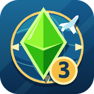
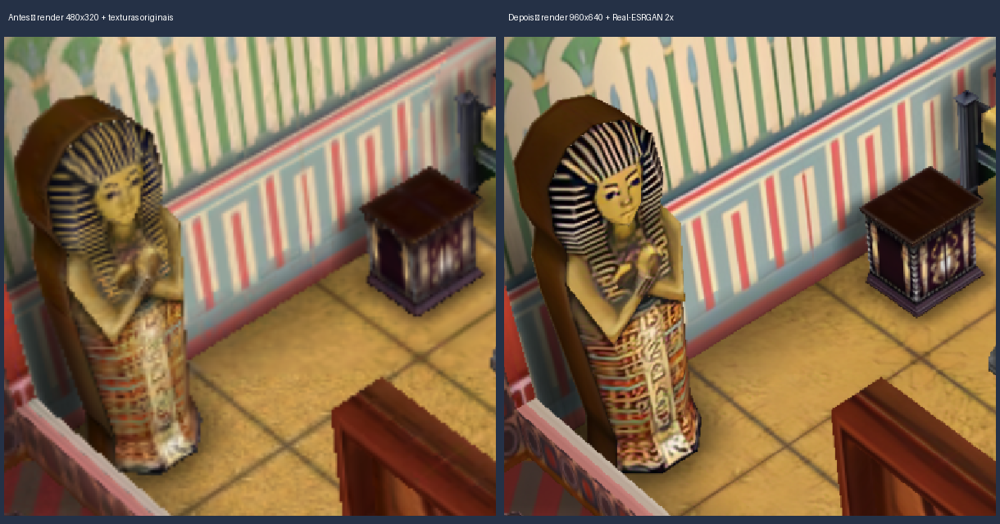
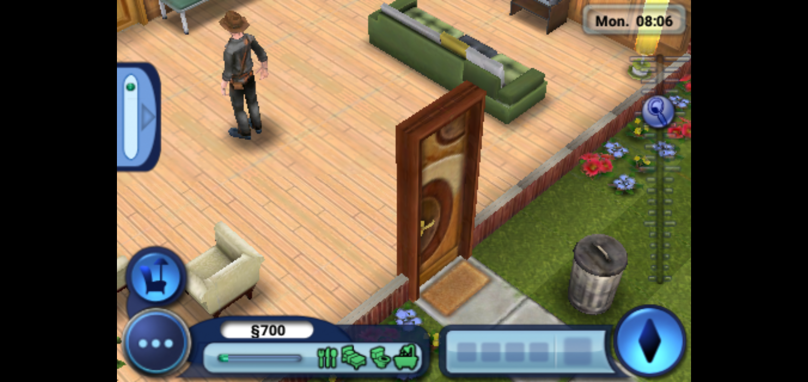

# The Sims 3 World Adventures — port comunitário para Android

Projeto de recuperação da versão iPhone de **The Sims 3 World Adventures**.



**Build ARM32 experimental funcionando no Galaxy A10 (Android 10).** Validado:
menu, criação de Sim com teclado Android, mundo 3D, caminhada/interação, cidade e
salvar/carregar. No perfil HD atual, trechos estáveis rodam perto de 60 FPS a 960×640.
Viagens, áudio e sessões mais longas continuam em validação.

**Atualização 0.0.3:** correção da T-pose, fontes nativas HD 2×, refinamento de 12 atlas de
ícones e opção de preencher a tela. Renderização 960×640 e pacote local com 979 imagens
ampliadas por Real-ESRGAN, testados no A10 perto de 60 FPS em trechos estáveis.
Veja [gráficos HD](docs/06-GRAFICOS-HD.md) e a comparação abaixo.





## Descoberta inicial

A cópia local 1.0.0 contém somente **ARMv6 de 32 bits**, diferente do Ambitions 1.1.84,
que oferece ARM64. O port reutiliza as APIs iOS reimplementadas no projeto de referência,
com novo loader e adaptações de ABI. O Galaxy A10 de teste suporta execução ARM32.
Androids exclusivamente 64-bit precisam de uma etapa adicional de tradução/emulação.

- [Sprints e resultados](docs/SPRINTS.md)
- [Análise do binário](docs/01-ANALISE-BINARIO.md)
- [Arquitetura](docs/02-ARQUITETURA.md)
- [Compilação e testes](docs/03-COMPILAR.md)
- [Guia experimental do jogador](docs/04-GUIA-DO-JOGADOR.md)
- [Prova de CPU emulada em host 64-bit](docs/05-EXECUCAO-EMULADA.md)
- [Extração, upscale e configuração HD](docs/06-GRAFICOS-HD.md)
- `tools/analyze_ipa.py`: relatório do Mach-O e extração local validada.
- `tools/bootstrap_reference.py`: importa apenas o scaffold/código do port de referência.
- `analysis/` e `extracted/`: artefatos locais, excluídos do versionamento.

O aplicativo usa o pacote próprio `com.ts3wa.port`. Cada jogador fornece sua cópia do
IPA; os arquivos do jogo não fazem parte do código do port. O APK experimental fica em
`dist/TS3WorldAdventures-0.0.4-arm32-hd-experimental.apk`. A 0.0.4 traz o novo ícone do launcher:
plumbob verde, globo/bússola dourada e avião, com recursos adaptativos e PNGs por densidade.
O pacote AI local fica separado
em `dist/TS3WorldAdventures-HD2x-UI-0.0.3-local.zip`; os artefatos anteriores são preservados.
Use **Voltar do Android → Tela** para comparar proporção original e preenchimento.
Ainda é necessário executar a
Sprint 4 para atender aparelhos que suportam apenas aplicativos de 64 bits.

## Compilar a partir do repositório

```bash
git clone https://github.com/Lucaslllll/the-sims-world-adventures.git
cd the-sims-world-adventures/android
# Configure o SDK local em local.properties, ou use ANDROID_HOME.
./gradlew assembleRelease --max-workers=2 --console=plain
```

Requisitos e testes: [03-COMPILAR.md](docs/03-COMPILAR.md).
A opção `--offline` só funciona depois de baixar as dependências do Gradle.
SDL2, OpenAL Soft e stb_image estão incluídos em `android/third_party/`, com suas licenças.

O repositório contém código, ferramentas, documentação, ícones autorais e capturas de
validação. IPA, executável original, modelos/texturas extraídos, pacotes HD, saves,
logs particulares e credenciais ficam no ambiente local. As capturas documentam o jogo;
o nome pessoal na imagem de criação do Sim foi ocultado para publicação.

- [Dependências e créditos](docs/DEPENDENCIAS.md)
- [Notas de continuidade](PROXIMA-SESSAO.md)
