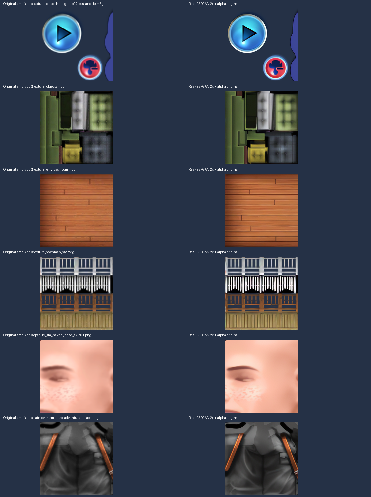
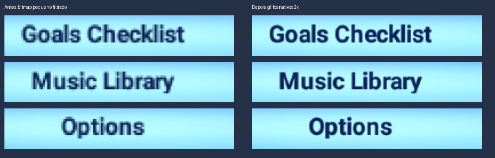
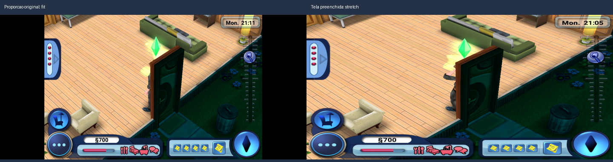

# Gráficos HD — renderização 2× e texturas com IA

Implementado e testado no Galaxy A10 em **2026-10-13**, versão
`0.0.2-arm32-hd-experimental`.


Esquerda: renderização 480×320 e recursos originais. Direita: renderização 960×640
e pacote Real-ESRGAN 2×. Mesma região do cenário egípcio carregado do save do usuário;
animações, iluminação e relógio não são perfeitamente sincronizados.

## Recursos extraídos

O IPA/bundle original continua intacto. A extração normalizada fica em
`analysis/graphics/originals/`, com catálogo e chaves de upload em `manifest.json`.

| Origem | Imagens |
|---|---:|
| PNG normal | 629 |
| PNG CgBI da Apple | 64 |
| M3G com PVRTC4 RGBA | 171 |
| M3G com PVRTC4 RGB | 54 |
| M3G RGBA sem PVRTC | 36 |
| M3G RGB sem PVRTC | 9 |
| TIFF | 16 |
| DAT RGB565 sem compressão | 35 |
| **Total** | **1.014** |

São **979 imagens únicas** após deduplicação. Todas as 270 imagens Image2D dos
containers M3G foram extraídas. Os 23 DAT restantes usam formatos comprimidos/proprietários
do diretório de outros jogos/loja; permanecem no original e são listados como não decodificados.

Os PNGs CgBI e PVRTC são decodificados com o mesmo stb/PVRTC do port, via um helper C++
no computador. Isso evita divergência entre a imagem usada no upscale e os pixels do jogo.

## Upscale

- Ferramenta portátil oficial **Real-ESRGAN ncnn Vulkan**, distribuição 20220424.
- Modelo **realesr-animevideov3-x2**; processamento offline na Intel UHD Graphics 620.
- 979 saídas RGBA com dimensões duplicadas: 128→256, 256→512, 512→1024 e 1024→2048.
- O modelo reconstrói RGB. Alpha vem exclusivamente do original, ampliado com Lanczos.
- RGB de bordas transparentes é estendido antes da inferência para reduzir halos escuros.
- Tamanho lógico, UVs e áreas dos sprites são preservados pelo loader de texturas.



O processamento completo levou aproximadamente 12 minutos no computador usado,
além da etapa de amostras. Não há inferência de IA durante o gameplay.

## Integração no port

### Resolução de renderização

`render_scale=2` mantém o iPhone lógico em 320×480 pontos, mas cria color/depth buffers
de 640×960 pixels. A apresentação os gira para **960×640 em paisagem**.

O port intercepta viewport, scissor, troca de FBO e consultas de tamanho do renderbuffer.
O jogo continua recebendo valores lógicos; o GL recebe valores físicos ampliados somente
no framebuffer da tela. Render targets offscreen conservam suas próprias dimensões.
O toque e o tamanho relativo dos controles permanecem no sistema original.

### Texturas de substituição

`texture_upscale=2` procura o pacote em `files/hdpack/manifest.tsv`.
O índice contém **4.264 chaves de upload original**, cobrindo PVRTC, RGB/RGBA, pixels
premultiplicados e representações RGB565/RGBA4444/RGBA5551.

As chaves FNV-1a de 64 bits incluem dimensões, formato, tipo e conteúdo original, sem padding
de linha. A substituição ocorre no upload GL: a imagem maior não altera os metadados M3G/UVs.
O alpha premultiplicado é reconstituído para uploads que exigem essa representação.

Cada textura HD recebe uma cadeia de mipmaps coerente. Os mipmaps originais menores são
ignorados, evitando textura incompleta. Updates parciais têm offsets e tamanhos escalados;
exclusão/reutilização de IDs remove a associação antiga.

Texturas compostas dinamicamente, como algumas partes do Sim, não possuem uma chave
pré-calculada no pacote. Nesses casos é aplicado upscale filtrado 2×. A partir de 0.0.3,
textos elegíveis têm rasterização nativa 2× e cache próprio, descritos abaixo.

### Fontes nativas HD — 0.0.3

`text_scale=2` rasteriza os glifos no Canvas Android em resolução física maior, conservando
as medidas lógicas. O contexto CoreGraphics mantém o buffer original sincronizado e publica
uma cópia HD RGBA em um cache LRU limitado a 32 MiB. Contextos elegíveis são bitmaps RGBA32
de até 1024×1024 lógicos; os demais continuam no caminho normal.

O jogo aloca texturas vazias e envia texto por `glTexSubImage2D`. Esse caminho agora
reconhece uma atualização completa do bitmap, promove a textura e gera seus mipmaps HD.
Uploads parciais não redimensionam uma textura original nem apagam seus outros pixels.
O log `HD glyph texture` confirma uso dos pixels rasterizados, em vez de ampliação filtrada.
`texture_upscale` precisa estar acima de 1 para publicar esses bitmaps na GPU.



Recortes do mesmo menu/tamanho de tela, ampliados igualmente por vizinho mais próximo
para evidenciar os pixels. O layout e as áreas de toque continuam originais.

### Refinamento de ícones — pacote UI 0.0.3

`tools/refine_ui.py` faz inferência RGB em 4× e redução Lanczos para as mesmas dimensões 2×
de **12 atlas de HUD/ícones**. O alpha é o mesmo original ampliado por Lanczos, e as outras
**967 imagens ficam byte a byte idênticas** ao pacote da Sprint 6. O ganho visual dos ícones
é mais sutil que o das fontes; a resolução e o custo das texturas GPU permanecem em 2×.

O pacote-base em `analysis/graphics/hdpack/` e seu ZIP anterior são preservados.
O resultado novo fica em `analysis/graphics/hdpack-ui/`, com proveniência em `pack.json`
e comparação em `analysis/graphics/ui-refinement/comparison.png`.

```bash
.venv/bin/python tools/refine_ui.py
.venv/bin/python tools/hdpack.py package --pack analysis/graphics/hdpack-ui \
    --output dist/TS3WorldAdventures-HD2x-UI-0.0.3-local.zip
.venv/bin/python tools/hdpack.py deploy --pack analysis/graphics/hdpack-ui \
    --apk dist/TS3WorldAdventures-0.0.3-arm32-hd-experimental.apk
```

### Preenchimento da tela

No botão **Voltar do Android → Tela**, selecione:

- **Proporção original (3:2)** (`screen_mode=fit`): padrão, preserva as proporções.
- **Preencher a tela** (`screen_mode=stretch`): usa toda a janela, esticando a imagem.

Também há um atalho **Tela** ao manter pressionado o ícone do app em launchers compatíveis.
A escolha é aplicada durante a sessão e salva em `config.txt`, preservando as outras opções.
Apresentação e toque usam a mesma transformação inversa. Não se trata de widescreen real:
o modo stretch mantém todo o HUD, mas alarga personagens, texto e botões em telas largas.



Capturas de sessões diferentes do mesmo save; animação e horário não são sincronizados.
O framebuffer continua 960×640 nos dois modos; a apresentação final é que muda.

## Reprodução e pacote local

```bash
.venv/bin/pip install -r tools/requirements-graphics.txt
.venv/bin/python tools/extract_graphics.py extracted/Payload/sims3wa_iphone.app
python3 tools/setup_upscaler.py
.venv/bin/python tools/upscale_graphics.py --samples
.venv/bin/python tools/upscale_graphics.py
.venv/bin/python tools/hdpack.py validate
.venv/bin/python tools/hdpack.py package
```

Pacote: `dist/TS3WorldAdventures-HD2x-local.zip`, aproximadamente **272,3 MiB**.
Contém derivados da cópia local do usuário e fica excluído do versionamento.
O APK continua separado dos dados do jogo.

Para instalar no aparelho a partir do computador, depois de salvar/encerrar a partida:

```bash
.venv/bin/python tools/hdpack.py deploy \
    --apk dist/TS3WorldAdventures-0.0.2-arm32-hd-experimental.apk \
    --serial SEU_SERIAL_ADB
```

O deploy faz backup de `home` e da configuração existente, transfere o pacote para uma
pasta temporária, publica `hdpack`, escreve as duas opções gráficas e atualiza o APK com `-r`.
Não precisa reimportar o IPA. A importação do HD ZIP pelo seletor Android ainda não está
implementada; este pacote é instalado pelo script/ADB.

## Configuração

`/sdcard/Android/data/com.ts3wa.port/files/config.txt`:

```ini
render_scale=2
texture_upscale=2
text_scale=2
screen_mode=fit
```

As escalas aceitam 1–4. O framebuffer/uploads são limitados pela capacidade do GL.
O perfil 2× foi testado; valores maiores precisam de medição. Para comparar com resolução,
texturas e fonte originais, use 1 nas três escalas e reinicie o aplicativo.
O pacote pode permanecer instalado. `screen_mode` aceita `fit` e `stretch`.

## Validação no A10

- Debug e release 0.0.2 instalados/testados, pacote de 4.264 chaves carregado.
- Log confirma framebuffer 320×480 lógico → 640×960 físico e uploads AI até 2048×2048.
- Menu e cenário egípcio: aproximadamente **60 FPS em trechos estáveis**.
  Leitura/decodificação dos atlas grandes têm quedas durante o carregamento.
- Não foram registrados crash ou `glGetError` no fluxo gráfico observado.
- `sim3dat0` e `sim3set` verificados byte a byte contra o backup: preservados.
- PSS observado perto de 102 MiB em uma amostra do debug. Memtrack não mede completamente
  todas as texturas GPU; sessão longa ainda precisa de acompanhamento.
- 13 testes Python passaram, incluindo integridade do pacote e alpha original.
- Regressão C++ passou: color/depth físicos, UI lógica, troca de FBO, mipmaps HD,
  subupdates, padding RGB e alpha premultiplicado.

Logs e backups em `analysis/graphics/`. Evidências em `docs/img/hd/`.

### Validação adicional 0.0.3

- Debug e release instalados no A10; fontes HD confirmadas em menu, dinheiro, relógio
  e diálogos. Mundo da casa e menus perto de 60 FPS em trechos estáveis.
- Tela preenchida e toque testados; opção original restaurada. Menu Android Voltar → Tela
  exercitado pelo botão de navegação real. A injeção de keyevents ADB não acionou Voltar/Home
  neste aparelho, embora os toques nos botões Android funcionem.
- Configuração persistiu entre reinstalação/reinício; não houve alteração dos hashes dos saves.
- PSS do release no mundo: 103.199 KiB (~100,8 MiB), mais SwapPSS de 21.146 KiB nessa amostra.
- Regressão GL cobre alocação vazia seguida de bitmap nativo completo, preservação de
  uploads parciais, limite de textura GPU, além dos casos anteriores. Regressão de viewport
  cobre fit/stretch, resize e inversão do toque em cantos/centro/botões.
- Logs/capturas em `analysis/ui-tests/`; backup do deploy em
  `analysis/graphics/device-before-hd-20261013-213515/`. Sessão longa continua pendente.

## Implementação

- `tools/extract_graphics.py`, `graphics_decode.cpp`, `setup_upscaler.py`, `upscale_graphics.py`
- `tools/hdpack.py`, `graphics_report.py`, `requirements-graphics.txt`
- `hle/texture_pixels.cpp/.h`, `hle/hd_textures.cpp/.h`, interceptações em `hle/gles.cpp`
- `tools/gen_gl_wrappers.py` gera exports a partir de `gl_funcs.inc`.

Modelo/ferramenta: <https://github.com/xinntao/Real-ESRGAN/releases/tag/v0.2.5.0>.
